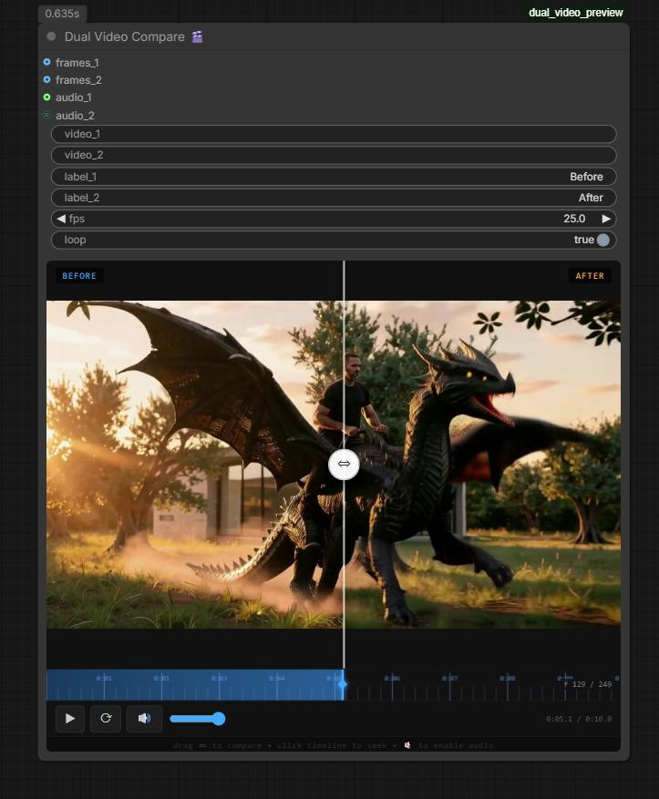

# Dual Video Compare for ComfyUI

Node to compare 2 videos with slider.
At this point pretty random collection of utility, model optimization and QoL nodes, while keeping dependencies at minimum.

Update 14-11-2026

- Bug´s Fix
- Loading the videos preview´s speed up increase, now much faster using GPU.

Documentation is mostly in the node descriptions and tooltips.

# Installation
1. Clone this repo into `custom_nodes` folder.
2. Restart ComfyUI,

 

 
